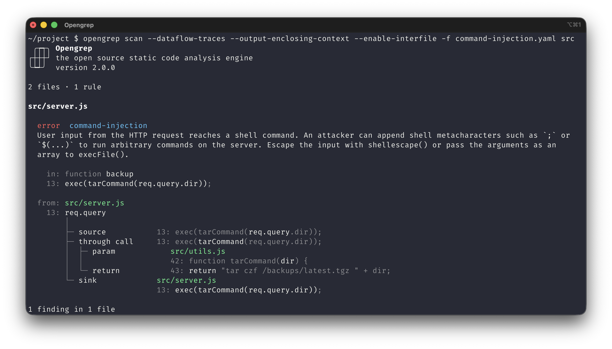

<br />
<p align="center">
  <a href="https://opengrep.dev/">
    <picture>
      <source media="(prefers-color-scheme: light)" srcset="images/opengrep-logo-light.svg">
      <source media="(prefers-color-scheme: dark)" srcset="images/opengrep-logo-dark.svg">
      
    </picture>
  </a>
</p>
<br />

Welcome to Opengrep! Opengrep is the most advanced open-source Static Application Security Testing (SAST) engine.

Opengrep is backed by a consortium of AppSec organisations, including: [Aikido](https://www.aikido.dev/), [Amplify](https://amplify.security/), [Endor Labs](https://www.endorlabs.com/), [Kodem](https://www.kodemsecurity.com/), and [Orca Security](https://orca.security/).

More information: [opengrep.dev](https://opengrep.dev/)

<p align="center">
  
</p>

## About

- Support for 30+ languages
- Semantic and type-aware matching
- Cross-function and cross-file taint tracking
- Advanced dataflow analysis: higher-order functions, field sensitivity, and more
- Superior performance: multicore parallelism with OCaml 5
- Self-contained, Cosign-signed binaries for Linux, macOS, and Windows
- Output formats: SARIF, JSON, and more
- Fine-grained memory and time limits
- Compatible with Semgrep rules

**Supported Languages:** Apex · Bash · C · C++ · C# · Clojure · Crystal · Dart · Dockerfile · Elixir · Go · HTML · Java · JavaScript · JSON · Jsonnet · JSX · Julia · Kotlin · Lisp · Lua · OCaml · PHP · Python · R · Ruby · Rust · Scala · Scheme · Solidity · Swift · Terraform · TSX · TypeScript · Visual Basic · XML · YAML · Generic (ERB, Jinja, etc.)

## Installation

### Quick install (recommended)

#### Linux / macOS

```bash
curl -fsSL https://raw.githubusercontent.com/opengrep/opengrep/main/install.sh | bash
```

Or if you've cloned the repo:

```bash
./install.sh
```

#### Windows (PowerShell)

```powershell
irm https://raw.githubusercontent.com/opengrep/opengrep/main/install.ps1 | iex
```

Or with a specific version:

```powershell
& ([scriptblock]::Create((irm https://raw.githubusercontent.com/opengrep/opengrep/main/install.ps1))) -Version v1.16.0
```

### Manual install

Binaries are available on the [releases page](https://github.com/opengrep/opengrep/releases).

On Windows, the package holds `opengrep.exe` and the DLLs it needs; keep them
together in the directory you install them to.

## For Agents

- [Skill](https://github.com/opengrep/skills/blob/main/skills/opengrep/SKILL.md) - install, write rules, run scans (`npx skills add opengrep/skills`)

## Documentation

- [Wiki](https://github.com/opengrep/opengrep/wiki) - tutorials and language guides
- [Intrafile Tainting Tutorial](https://github.com/opengrep/opengrep/wiki/Intrafile-tainting-tutorial)
- [Higher-Order Functions Tutorial](https://github.com/opengrep/opengrep/wiki/Higher-order-functions-tutorial)

## Community

- [X / Twitter](https://x.com/opengrep)
- [Reddit](https://www.reddit.com/r/opengrep)
- [opengrep.dev](https://opengrep.dev/) - more information

## More

- [Contributing](CONTRIBUTING.md)
- [Build instructions for developers](INSTALL.md)
- [License (LGPL-2.1)](LICENSE)

---

_Opengrep is a fork of Semgrep v1.100.0, created by Semgrep Inc. Opengrep is not affiliated with or endorsed by Semgrep Inc._
